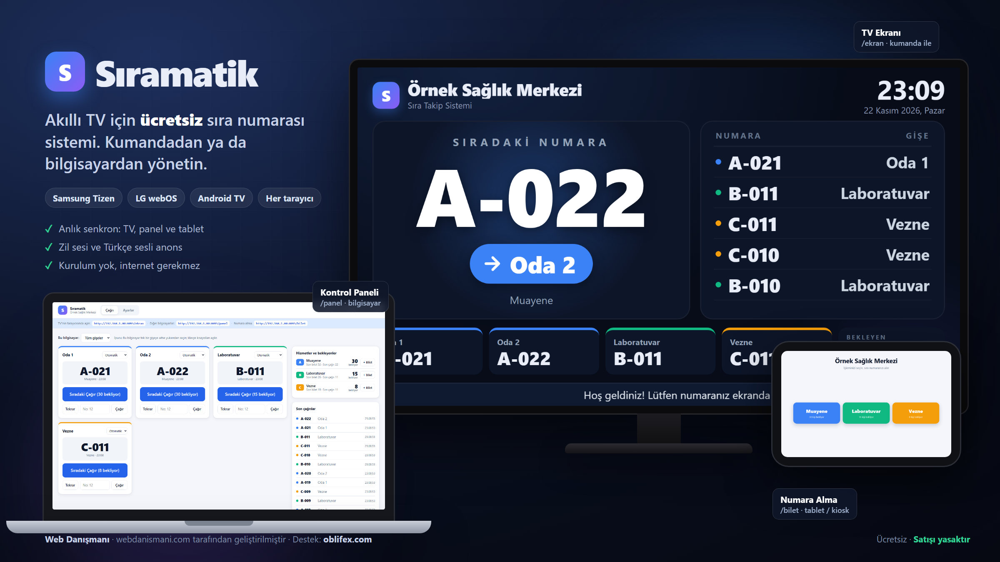
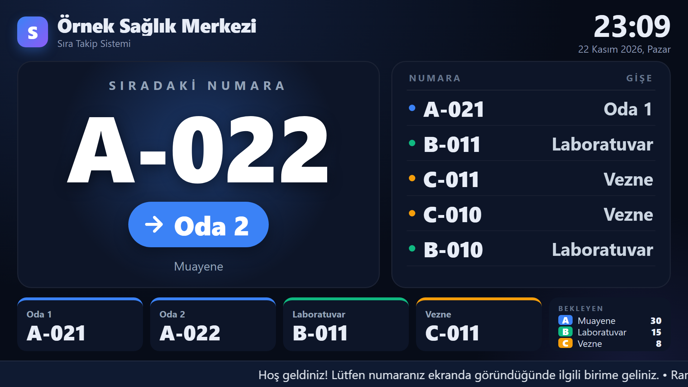
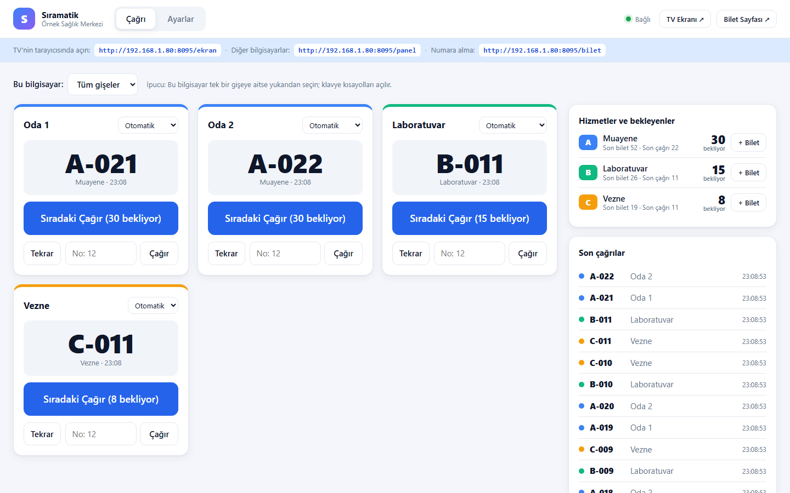
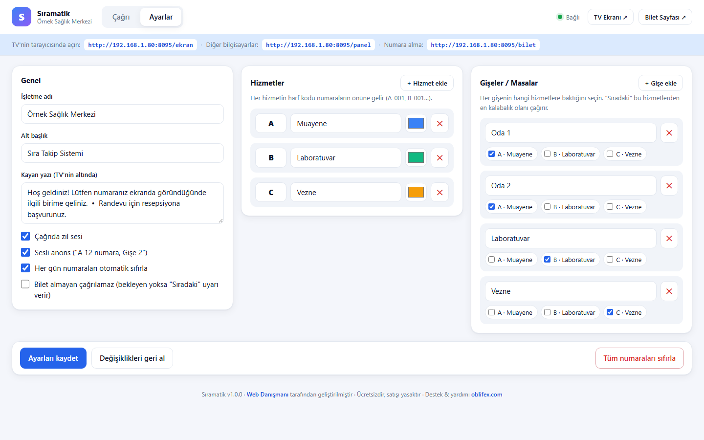
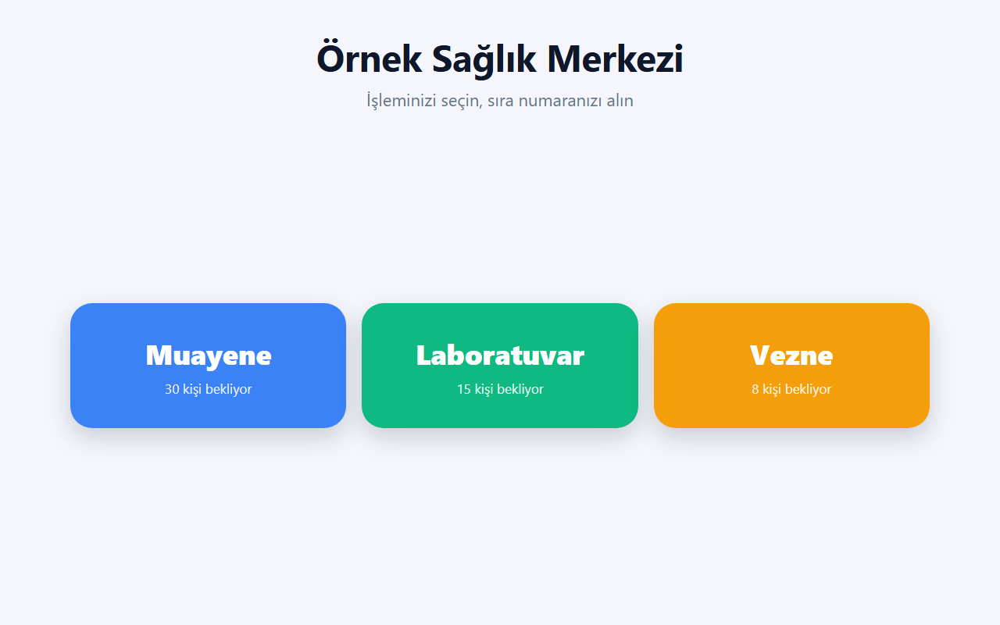

<div align="center">

# Sıramatik

**Akıllı TV için ücretsiz sıra numarası sistemi**

Klinik, banka, eczane, belediye ve servis noktaları için. TV'de büyük sıra ekranı, bilgisayardan veya TV kumandasından kontrol, tablet/kiosk'tan numara alma. Hepsi **aynı yerel ağda** çalışır, internet gerekmez.


[**⬇ İndir (Releases)**](../../releases/latest) · [Kurulum](#hızlı-başlangıç) · [Kumanda](#tv-kumandası-ile-kontrol) · [Destek: oblifex.com](https://oblifex.com)



<sub>**Web Danışmanı** ([webdanismani.com](https://webdanismani.com)) tarafından geliştirilmiştir. Ücretsizdir, **satışı yasaktır**.</sub>

</div>

## Ekran görüntüleri

| TV sıra ekranı | Kontrol paneli |
|---|---|
|  |  |
| **Ayarlar** | **Numara alma (tablet / kiosk)** |
|  |  |

## Nasıl çalışır

```
        ┌──────────────── Bilgisayar ────────────────┐
        │  sunucu.py  (durum + anlık yayın, :8080)   │
        └───────┬───────────────┬───────────────┬────┘
                │ Wi-Fi / LAN   │               │
        ┌───────▼──────┐ ┌──────▼──────┐ ┌──────▼──────┐
        │  TV /ekran   │ │ PC /panel   │ │ Tablet      │
        │  + kumanda   │ │ (1..n adet) │ │ /bilet      │
        └──────────────┘ └─────────────┘ └─────────────┘
```

Kumandadan da bilgisayardan da yapılan her çağrı sunucuya gider; tüm ekranlar anında (Server-Sent Events) güncellenir.

## Hızlı başlangıç

0. [Releases](../../releases/latest) sayfasından `siramatik-v1.0.0.zip` dosyasını indirip bir klasöre çıkarın. Python yoksa [python.org](https://www.python.org/downloads/) adresinden kurun ve kurulumda **"Add python.exe to PATH"** kutusunu işaretleyin.
1. **`BASLAT.bat`** dosyasına çift tıklayın. Linux/macOS'ta `python3 sunucu.py` ile başlatın.
2. Açılan pencerede adresler yazar, örneğin:
   ```
   TV ekranı     : http://192.168.1.20:8080/ekran
   Kontrol paneli: http://192.168.1.20:8080/panel
   Bilet sayfası : http://192.168.1.20:8080/bilet
   ```
3. Windows güvenlik duvarı sorarsa **Özel ağlar** için izin verin.
4. TV'nin **internet tarayıcısında** ekran adresini açın (Samsung "Internet", LG "Web Browser").
5. Bilgisayarda panel adresini açın ve **Ayarlar** sekmesinden işletme adını, hizmetleri ve gişeleri düzenleyin.

> Farklı port için: `python sunucu.py 8090`

## Sayfalar

| Adres | Ne işe yarar |
|---|---|
| `/ekran` | TV sıra ekranı: büyük numara, gişe, son 5 çağrı, gişe durumları, bekleyen sayıları, saat, kayan yazı. Yeni çağrıda yanıp söner, zil çalar ve Türkçe sesli anons yapar. |
| `/panel` | Kontrol paneli: her gişe için **Sıradaki Çağır**, **Tekrar**, belirli numarayı çağırma, bilet verme, ayarlar. Birden fazla bilgisayardan aynı anda açılabilir. |
| `/panel#ayarlar` | Paneli doğrudan Ayarlar sekmesinde açar. |
| `/bilet` | Müşterinin numara aldığı dokunmatik sayfa (tablet/kiosk). 80 mm fiş yazıcıya uygun baskı. `/bilet?yazdir=1` her bilette otomatik yazdırır. |

### Paneldeki "Bu bilgisayar" seçimi
Her masada ayrı bilgisayar varsa üstten o gişeyi seçin. Ekranda yalnızca o gişe büyük görünür ve klavye kısayolları açılır:
**Boşluk / Enter** sıradakini çağırır, **T** tekrar çağırır.

## TV kumandası ile kontrol

Ekran açıkken:

| Tuş | İşlev |
|---|---|
| **OK** veya **▶** | İlk basış kumanda menüsünü açar, ikinci basış **sıradakini çağırır** (yanlışlıkla çağrıyı önler) |
| **▲ / ▼** | Gişe değiştir |
| **◀** | Seçili gişenin son numarasını tekrar çağır |
| **1–9** | Gişeyi numarasıyla seç |
| **Yeşil** | Doğrudan sıradakini çağır |
| **Kırmızı** | Tekrar çağır |
| **Sarı** | Bu TV'de anons sesini aç/kapat |
| **Mavi** | Yardım ve bağlanma adresleri |
| **Geri** | Açık menüyü kapat |

> Renkli ve rakam tuşları, TV'nin tarayıcısında üretici tarafından engellenebilir. Bütün tuşların çalışması için aşağıdaki gibi TV uygulaması olarak kurun. Ok tuşları ve OK her durumda çalışır.

**Ses notu:** Tarayıcılar, kullanıcı etkileşimi olmadan ses çalmaya izin vermez. Ekran açıldıktan sonra kumandadan bir kez **OK**'a basın. Altta turuncu uyarı varsa ses henüz açılmamıştır. Sesli anons, TV'nin konuşma motoruna bağlıdır; desteklemeyen TV'lerde yalnızca zil çalar.

## TV uygulaması olarak kurmak (isteğe bağlı)

```
python tv-hazirla.py
```
Bu komut `tv-uygulamasi/tizen` (Samsung) ve `tv-uygulamasi/webos` (LG) klasörlerini üretir. Uygulama ilk açılışta sunucu adresini sorar (örn. `192.168.1.20:8080`), sonra açılışta doğrudan ekrana bağlanır. Adresi değiştirmek için **Mavi** tuşa basın.

**Samsung (Tizen):**
1. [Tizen Studio](https://developer.samsung.com/smarttv/develop/getting-started/setting-up-sdk/installing-tv-sdk.html) + TV eklentisini kurun ve bir Samsung sertifikası oluşturun (Certificate Manager).
2. TV'de *Apps* bölümünde `1-2-3-4-5` tuşlayarak **Developer Mode**'u açın ve bilgisayarın IP'sini girin.
3. Tizen Studio'da *File › Import › Tizen Project* ile `tv-uygulamasi/tizen` klasörünü içe aktarın, *Run As › Tizen Web Application* ile TV'ye yükleyin.

**LG (webOS):**
1. [webOS TV CLI](https://webostv.developer.lge.com/develop/tools/cli-installation)'yi kurun. TV'de LG Content Store'dan **Developer Mode** uygulamasını yükleyip açın.
2. `ares-setup-device` ile TV'yi ekleyin.
3. Paketleyip yükleyin:
   ```
   ares-package tv-uygulamasi/webos
   ares-install com.siramatik.ekran_1.0.0_all.ipk
   ares-launch com.siramatik.ekran
   ```

**Android TV / TV Box:** Tarayıcıdan `/ekran` adresini tam ekran açmak yeterlidir. Kiosk tarayıcı uygulamalarıyla (ör. Fully Kiosk) açılışta otomatik başlatılabilir.

## Ayarlar

- **Hizmetler:** Harf kodu (A, B…), ad ve renk. Numaralar `A-001` biçimindedir.
- **Gişeler:** Her gişenin baktığı hizmetler. "Sıradaki", bu hizmetlerden en çok bekleyeni olanı çağırır; gişe kartındaki açılır listeden belirli bir hizmet de seçilebilir.
- **Günlük sıfırlama:** Gece yarısı numaralar otomatik olarak 1'den başlar.
- **Bilet zorunlu:** Açıkken bilet almamış numara çağrılamaz. Kapalıyken (varsayılan) bilet sistemi olmadan da "Sıradaki" ile sayaç ilerler.

Tüm durum `veri.json` dosyasında saklanır; sunucu yeniden başlasa da numaralar korunur. Bu dosyayı silmek fabrika ayarlarına döndürür.

## Sorun giderme

| Belirti | Çözüm |
|---|---|
| TV sayfayı açamıyor | TV ve bilgisayar aynı ağda mı? Güvenlik duvarında Python'a izin verin. Misafir Wi-Fi'ler cihazları birbirinden yalıtır. |
| Ekranda "Sunucu bağlantısı yok" | Sunucu penceresi kapanmış olabilir. Bağlantı geri gelince ekran kendiliğinden düzelir. |
| Ekran güncellenmiyor ama bağlantı var | Ağdaki bir proxy anlık akışı engelliyor olabilir. Adresin sonuna `?yokla=1` ekleyin (2 saniyede bir yoklar). |
| IP sürekli değişiyor | Modem arayüzünden bilgisayara sabit IP (DHCP rezervasyonu) verin. |

## Dosya yapısı

```
siramatik/
├── BASLAT.bat          Çift tıkla başlat
├── sunucu.py           HTTP + SSE sunucusu, iş kuralları (yalnız standart kütüphane)
├── tv-hazirla.py       Tizen / webOS paket klasörlerini üretir
├── paketle.py          GitHub sürümü için dist/siramatik-vX.Y.Z.zip üretir
├── docs/gorseller/     README görselleri ve sosyal önizleme
├── veri.json           Çalışma anında oluşur (durum)
├── genel/
│   ├── ortak.js        Bağlantı katmanı (ES5, eski TV tarayıcıları uyumlu)
│   ├── ekran.html/css/js   TV ekranı + kumanda
│   ├── panel.html/css/js   Kontrol paneli
│   └── bilet.html      Numara alma sayfası
└── tv-uygulamasi/      tv-hazirla.py çıktısı
```

## API (entegrasyon için)

- `GET /api/durum`: tüm durum (JSON)
- `GET /api/akis`: Server-Sent Events, her değişiklikte tam durum
- `POST /api/islem` (gövde JSON):
  - `{"islem":"sonraki","gise":1,"hizmet":"A"}` (`hizmet` isteğe bağlı)
  - `{"islem":"tekrar","gise":1}`
  - `{"islem":"cagir","gise":1,"hizmet":"B","numara":12}`
  - `{"islem":"bilet","hizmet":"A"}` → `{numara, onunuzde, ...}`
  - `{"islem":"sifirla"}`
  - `{"islem":"ayar","ayarlar":{...},"hizmetler":[...],"giseler":[...]}`

## Güvenlik notu

Panel şifresizdir ve yerel ağdaki herkes erişebilir. Misafirlere açık bir ağda kullanacaksanız sunucuyu yalnızca personel ağında çalıştırın.

## Destek & yardım

Kurulum ve kullanım soruları için **[oblifex.com](https://oblifex.com)** forumumuzu kullanın.
Yazılım hatalarını GitHub **Issues** üzerinden bildirebilirsiniz.

## Lisans

**Ücretsiz kullanım, satış yasağı.** Ayrıntılar için [LICENSE](LICENSE) dosyasına bakın.

- ✅ Kişisel olarak veya kendi işletmenizde ücretsiz kullanabilir, değiştirebilir ve ücretsiz paylaşabilirsiniz.
- ❌ Yazılım veya türevleri satılamaz, kiralanamaz, ücretli hizmet olarak sunulamaz, yeniden markalanamaz.
- ❌ Yapımcı bilgisi ve lisans metni kaldırılamaz.

Ticari izin ve kurulum hizmeti için: [webdanismani.com](https://webdanismani.com)

---

<div align="center">
<b>Sıramatik</b>, <a href="https://webdanismani.com">Web Danışmanı</a> tarafından geliştirilmiştir.<br>
Destek: <a href="https://oblifex.com">oblifex.com</a>
</div>
